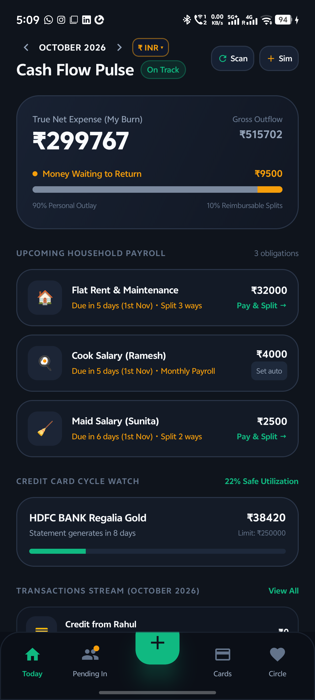

# KOSH (कोश) — Your Private Financial Treasury

<div align="center">
  
  <br/><br/>
  
  [](https://github.com/ayushk-yb/kosh)
  [](https://kotlinlang.org)
  [](https://developer.android.com/jetpack/compose)
  [](https://github.com/ayushk-yb/kosh)
  [](LICENSE)

  <br/>

  ### **A zero-cloud, SMS-first smart expense & outlay tracker designed for real life in India.**
  *Stop letting traditional budget apps lie to you about your pocket expenses.*

  <br/>

  <a href="https://github.com/ayushk-yb/kosh/releases/latest/download/Kosh-v1.1.0.apk">
    
  </a>
  <br/>
  <sub>Direct download • 18.2 MB • Android 8.0 (API 26) and above</sub>
</div>

---

## 📸 Sneak Peek

<div align="center">
  
  <p><em>Real-time True Net Expense, smart credit card countdown, and intelligent SMS stream.</em></p>
</div>

---

## 💡 Why Kosh? The Problem with Standard Expense Trackers

Every modern expense app makes the same fundamental mistakes:

1. **The "Gross Outflow" Fallacy**:  
   You go to dinner with three friends. The bill is ₹4,000. You swipe your card, and your friends UPI you their shares later.  
   *Traditional apps report that you spent ₹4,000 on Food!* Your monthly budget looks ruined even though your actual pocket expense was only ₹1,000.
2. **The "Awkward Debt" Syndrome**:  
   When you buy a gift for your partner or treat your family, standard split apps treat them like awkward borrowers in a debt ledger. Real relationships don't work like business IOUs.
3. **Manual Entry Exhaustion**:  
   Nobody wants to open an app and manually log every ₹30 chai or UPI grocery transfer. You forget, and within two weeks your tracking is broken.
4. **Cloud Privacy Nightmare**:  
   Most financial apps upload your full SMS inbox, bank balances, and merchant records to their cloud servers to train marketing models or sell loans.

**Kosh was built from the ground up to solve all four problems.**

---

## ✨ Unique Features Built for Real Life

### 🧠 1. True Net Expense vs. Gross Outflow
Kosh simultaneously calculates two financial realities:
* **Gross Outflow**: Exactly how much money left your card, bank, or wallet this month (crucial for cash flow and credit limits).
* **True Net Expense**: What you *actually* personally consumed, with all receivables automatically subtracted.
* When friends pay you back, Kosh reconciles the return with bright green inflow indicators (`+₹65,000`) without corrupting your spend charts.

### 👥 2. Flexible Multi-Person & Open Splitting
* **Multi-Person Selection**: Split bills across 2, 5, or 10 friends with checkboxes in one tap.
* **Equal vs. Custom Shares**: Toggle between an even split with live avatar chips (`👤 You`, `Rahul`, `Aman`) or custom numerical inputs for unequal tabs.
* **⚡ My Share Only (Open Split)**: Don't know who's paying what yet? Enter just what you ate (e.g. ₹400 on a ₹2,400 bill). The remaining ₹2,000 is safely cataloged under **General Split**, ready to be settled partially or completely through one or multiple incoming payments later.
* **Partial Settlement**: When friends pay you back in installments or hand you cash, record partial settlements with custom amounts and direct transaction linking.

### ⚡ 3. Autonomous On-Device SMS Detection (100% Private)
* **Zero Cloud**: Your SMS messages **never** leave your phone. Ever. No telemetry, no remote servers, no account required.
* **Comprehensive Indian Bank Support**: Intelligently identifies transactions from **HDFC, ICICI, SBI, Axis, Kotak, PNB, Bank of Baroda, Canara, IDFC FIRST, IndusInd, Federal Bank, Yes Bank, RBL**, and more.
* **All Transaction Channels**: Seamlessly parses **UPI, Debit Cards, Credit Cards, ATM withdrawals, and NEFT / IMPS / RTGS bank transfers**.
* **Auto Card & Account Mapping**: Matches payments to your specific card (e.g., *"HDFC Millennia (4450)"*) and displays friendly merchant names.

### 💳 4. Smart Credit Card Utilization & Due Date Countdowns
* Track each card's **Billing Cycle Statement Date** and **Payment Due Date**.
* Visual warning countdown pills (e.g., `⚡ Due in 4 days`).
* Real-time credit limit utilization indicators (stay below 30% for a healthy CIBIL score).

### 🏠 5. Fixed Monthly Obligations & Household Bills
* Manage recurring commitments like **Rent, Maintenance, Wi-Fi, Cook, Maid, and Electricity**.
* 1-tap **"Pay & Split"** with flatmates that remembers your split settings every month.
* **Tap-to-Undo Protection**: Accidental clicks can be undone with a single tap, cleanly restoring balances.

### 📈 6. Wealth & SIP Isolation
* Mutual Fund SIPs, Stocks, PPF, and Insurance shouldn't be counted as "living expenses".
* Toggle **"Mark as Investment / SIP"** to track wealth creation separately from your living burn rate.

### 🎨 7. Obsidian Dark Aesthetic
* High-contrast, battery-saving dark interface designed for OLED screens.
* Styled with curated accent palettes:
  * **Electric Mint** (`#10B981`) for positive inflows & savings
  * **Amber Gold** (`#FFBF00`) for receivables & pending splits
  * **Partner Pink** (`#F472B6`) for companion & gift tags
  * **Royal Blue** (`#3B82F6`) for investments & card limits

---

## 📥 Download & Installation

### Option 1: Direct APK Download (Recommended)
1. Download the latest release from GitHub:  
   👉 **[Download Kosh v1.1.0 APK](https://github.com/ayushk-yb/kosh/releases/latest/download/Kosh-v1.1.0.apk)** *(or get it from the [`release/`](release/) folder in this repository)*.
2. Tap the downloaded `.apk` file on your Android device.
3. If prompted, allow **"Install from unknown sources"** for your browser or file manager.
4. Open **Kosh** and grant SMS permissions so it can scan your transactions locally.

> **Privacy Guarantee**: Kosh uses Android's `READ_SMS` and `RECEIVE_SMS` permissions strictly inside your device. The app has **zero internet tracking or cloud sync**. Your financial data never leaves your device's encrypted local database.

---

## 🛠️ Technical Architecture

Kosh is built adhering to Google's Modern Android Development (MAD) practices:

* **UI Toolkit**: 100% declarative UI with [Jetpack Compose](https://developer.android.com/jetpack/compose) and Material 3 design system.
* **Language**: Kotlin 2.1.0 with Coroutines and StateFlow for reactive, lifecycle-aware UI updates.
* **Architecture**: Clean MVVM (Model-View-ViewModel) with unidirectional data flow (UDF).
* **Local Database**: [Room SQLite](https://developer.android.com/training/data-storage/room) with multi-table relational indexing (`transactions`, `split_debts`, `person_ledgers`, `household_obligations`, `payment_instruments`, `custom_categories`).
* **SMS Engine**: Dual-layer architecture combining a live `SmsBroadcastReceiver` for incoming alerts and a fast asynchronous `SmsAutoScanner` inbox engine with SHA-256 deduplication hashing.

```
com.kosh.app
├── data
│   ├── local        # Room Database, TypeConverters, DAOs
│   ├── model        # Entity definitions & domain models
│   ├── repository   # Single source of truth for all business operations
│   └── scanner      # High-performance regex bank SMS parser
├── receiver         # Real-time incoming SMS broadcast receiver
├── ui
│   ├── components   # Modular sheets (Edit, Split, Settle, PersonPicker)
│   ├── screens      # Dashboard, Splits, Cards, Analytics, All Transactions
│   ├── theme        # Obsidian dark theme, typography, color palettes
│   └── viewmodel    # KoshViewModel managing reactive UI state flows
└── MainActivity.kt  # Root Compose scaffold & navigation state
```

---

## 🏗️ Building from Source

If you prefer building Kosh yourself:

### Prerequisites
* Android Studio Ladybug / Meerkat or newer
* JDK 17 or higher
* Android SDK 35 (Platform 35, Build Tools 35.0.0)

### Steps
```bash
# 1. Clone the repository
git clone https://github.com/ayushk-yb/kosh.git
cd kosh

# 2. Build the debug APK
./gradlew assembleDebug

# 3. Install directly to a connected phone
adb install -r app/build/outputs/apk/debug/app-debug.apk
```

---

## 🔒 Security & Permissions

| Permission | Justification |
| :--- | :--- |
| `READ_SMS` | Scans historical bank & UPI debit/credit notifications to build your financial timeline locally. |
| `RECEIVE_SMS` | Listens for live SMS notifications to automatically log payments the second they happen. |
| `READ_CONTACTS` | *(Optional)* Lets you pick flatmates or friends directly from your address book for bill splits. |

*Kosh contains zero advertising networks, zero third-party tracking SDKs, and zero cloud uploads.*

---

## 🤝 Contributing & Feedback

Found a bank SMS pattern that wasn't parsed properly or want to suggest a new feature?
1. Open an [Issue](https://github.com/ayushk-yb/kosh/issues).
2. Submit a Pull Request.

---

<div align="center">
  <sub>Crafted with ❤️ for personal financial clarity.</sub><br/>
  <sub><b>Kosh (कोश)</b> • Zero Cloud • 100% Private</sub>
</div>
